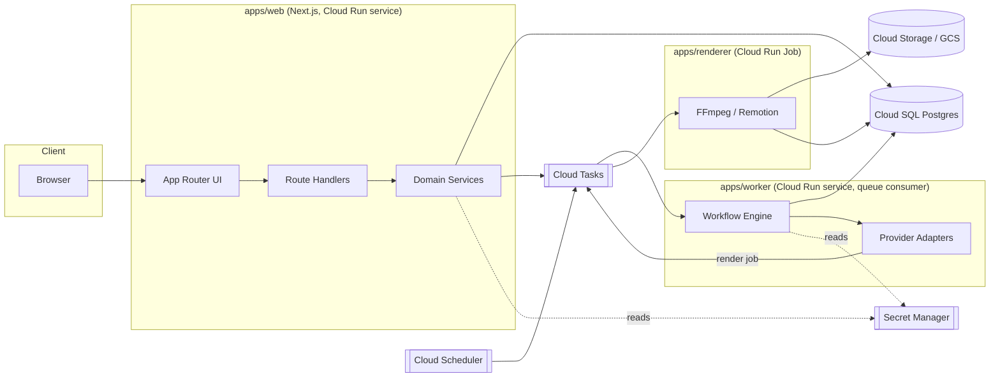
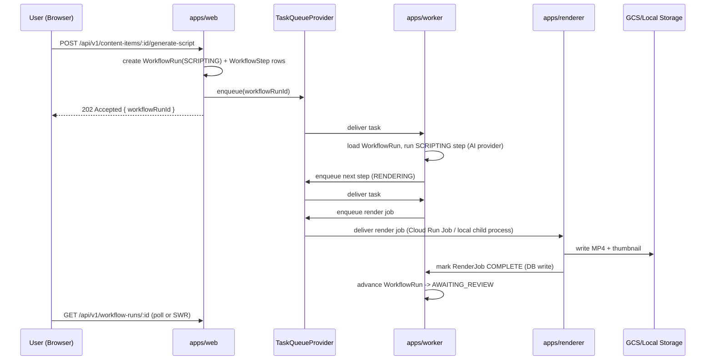

# ContentForge — Architecture

## 1. Shape: modular monolith + two deployables

One Next.js application owns all HTTP/UI surface. Two separate long-running
processes exist only because their workloads are fundamentally different from
a web request (they are long-lived, CPU/IO heavy, and must survive web
instance restarts):

- **apps/web** — Next.js (App Router). All UI, all route handlers, all Zod
  validation, all authz. Talks to Postgres via `packages/database` and
  enqueues work via `packages/workflows`' `TaskQueueProvider`.
- **apps/worker** — polls/consumes the task queue, advances
  `WorkflowRun`/`WorkflowStep` state, calls AI/social/email providers,
  never renders media itself (delegates to the renderer).
- **apps/renderer** — isolated process/container that only does FFmpeg /
  Remotion work. Isolated because media rendering is CPU/memory heavy,
  benefits from its own container image (ffmpeg binary, fonts, Chromium for
  Remotion) and its own scaling/timeout/crash policy, and must never share a
  process with request handling.

No other services are split out. Everything else (brand, campaigns,
approvals, billing, analytics) is modeled as domain modules inside
`packages/*` and consumed by `apps/web` and `apps/worker`. This satisfies "do
not create unnecessary microservices" while still giving rendering and
background work their own deployable/scalable/crashable unit, matching the
Cloud Run + Cloud Run Jobs + Cloud Tasks target deployment.



## 2. Domain modules (packages)

| Package              | Domains owned                                                                                                                                                                               |
| -------------------- | ------------------------------------------------------------------------------------------------------------------------------------------------------------------------------------------- |
| `packages/database`  | Prisma schema, migrations, seed, typed repositories                                                                                                                                         |
| `packages/auth`      | Auth.js config, session/workspace/RBAC guards                                                                                                                                               |
| `packages/shared`    | Cross-cutting: Zod schemas, error types, ids, money, pagination, logging, env                                                                                                               |
| `packages/config`    | Shared tsconfig/eslint/prettier/tailwind presets                                                                                                                                            |
| `packages/ai`        | TextGenerationProvider, EmbeddingProvider, ImageGenerationProvider, VideoGenerationProvider, TextToSpeechProvider, TranscriptionProvider + mock impls + structured-output validation/repair |
| `packages/media`     | Rendering pipeline (FFmpeg/Remotion), caption burning, thumbnailing, ObjectStorageProvider                                                                                                  |
| `packages/social`    | SocialPlatformProvider + adapters (mock/instagram/facebook/threads/tiktok/youtube/x)                                                                                                        |
| `packages/workflows` | Deterministic workflow/state-machine engine, TaskQueueProvider, dead-letter handling                                                                                                        |
| `packages/billing`   | Stripe integration, plan/usage enforcement                                                                                                                                                  |
| `packages/ui`        | Design system (Tailwind + shadcn-style primitives)                                                                                                                                          |

Domain boundary inside `packages/database` and `apps/web/src/server`: each
business domain (brand, campaign, content, approval, publishing, analytics,
billing, notifications, admin, audit) gets its own service module under
`apps/web/src/server/services/<domain>`. Route handlers are thin: parse with
Zod, call a service, map result/errors to HTTP. No business logic lives in a
route handler.

## 3. Provider abstraction pattern

Every external capability is defined as a TypeScript interface in
`packages/ai`, `packages/media`, `packages/social`, or `packages/shared`
(email/analytics). Each interface:

1. Returns **normalized domain types**, never a provider's raw response shape.
2. Classifies errors into `ProviderError` with a `retryable: boolean` and a
   `category` (`TRANSIENT | RATE_LIMIT | AUTH | VALIDATION | UNSUPPORTED`).
3. Enforces a timeout via `AbortController`.
4. Reports `{ costUsd, tokensIn, tokensOut, durationMs }` usage back to the
   caller so `packages/workflows` can persist it on `ProviderUsage`.
5. Exposes `healthCheck()` and `validateConfig()` used by the admin
   "Provider health" page and by startup secret validation.

Mock implementations are first-class, not test doubles bolted on after the
fact — they are what the local demo runs against, selected via
`AI_PROVIDER=mock`, `SOCIAL_MOCK=true`, etc. in `.env`.

## 4. Workflow engine

See [WORKFLOWS.md](WORKFLOWS.md) for the full state machine. Summary: a
`WorkflowRun` is a persisted row with a `type`, `status`, and ordered
`WorkflowStep` children. The worker advances one step at a time; every step
records inputs, outputs, cost, retry count, and an idempotency key. A step
that exhausts retries moves the run to `FAILED` and creates/updates a
dead-letter-visible record an admin can retry from `/admin/jobs/failed`.
Publishing steps are additionally guarded by a unique idempotency constraint
on `PublishJob` so the same `ContentVariant`+`SocialAccount` pair can never be
published twice.

## 5. Data flow: request → queue → worker → renderer



## 6. Local dev vs. cloud target

| Concern          | Local                                                                     | Cloud (GCP)                                        |
| ---------------- | ------------------------------------------------------------------------- | -------------------------------------------------- |
| Postgres         | Docker Compose `postgres:16` (see §7 below for this sandbox's constraint) | Cloud SQL for Postgres                             |
| Object storage   | Local filesystem adapter (`packages/media` `LocalObjectStorageProvider`)  | GCS                                                |
| Task queue       | In-process/Postgres-backed local queue adapter (polling)                  | Cloud Tasks                                        |
| Scheduler        | `node-cron` in the worker                                                 | Cloud Scheduler → Cloud Tasks HTTP target          |
| Secrets          | `.env` (never committed; `.env.example` only)                             | Secret Manager, mounted as env vars at deploy time |
| Renderer         | Child process running FFmpeg/Remotion on the host                         | Cloud Run Job                                      |
| Social platforms | `MockSocialPlatformProvider`                                              | Real OAuth apps once approved                      |

## 7. Local verification strategy inside this build sandbox

This repository was built in a sandbox with **no Docker and no system
PostgreSQL**. `docker-compose.yml` is still the documented, primary local-dev
path (`docs/local-development.md`) and is what CI and any real developer
machine uses. To still exercise migrations/seed/integration tests inside this
sandbox, `packages/database`'s test harness starts a throwaway
`embedded-postgres` process (a portable, non-service Postgres binary, no
admin rights, no system install) bound to a random local port, runs
migrations against it, and tears it down after the test run. This is called
out again in the README so it is never mistaken for the supported path.

## 8. Key architectural decisions (ADR-style log)

1. **Modular monolith, not microservices.** Team size (effectively one
   engineer at a time) and brief explicitly forbid unnecessary service
   splits. Only rendering and background workflow processing get their own
   deployable, because their scaling/crash/timeout profile genuinely differs
   from request/response.
2. **Deterministic workflow engine over an autonomous agent.** Every
   generation/publish path is a fixed set of typed steps persisted to
   Postgres, not an LLM deciding what to do next. This gives resumability,
   auditability, and hard spending caps — required by the brief and by
   basic cost safety.
3. **Provider interfaces return normalized types.** Keeps `packages/ai`,
   `packages/social`, `packages/media` swappable and keeps provider-specific
   shapes out of domain logic and out of the database.
4. **Mock providers are first-class**, not test-only. The entire demo flow
   runs on mocks; real providers are additive, feature-flagged by env vars.
5. **Postgres-backed local queue adapter**, not Redis/BullMQ, for local dev —
   avoids introducing a new local service when the brief already asks for
   Docker Compose to be minimal ("no paid service should be required"); the
   same `TaskQueueProvider` interface is implemented by a Cloud Tasks adapter
   for deployment.
6. **Soft delete via `deletedAt`** on workspace-owned, user-visible entities
   (Brand, Campaign, ContentItem, MediaAsset, SocialConnection) — supports
   the required data-deletion workflow without losing audit trail integrity;
   hard delete is reserved for the explicit account-deletion workflow after a
   grace period.
7. **RBAC as data, not code constants** — `WorkspaceMembership.role` enum
   checked by a single `assertWorkspacePermission()` guard used by every
   route handler, so permission changes are a one-place edit.
8. **Dependency version policy**: every dependency is pinned to the newest
   _patch_ release of a major version line I have high confidence is
   internally consistent and well-documented (verified against the live npm
   registry during Phase 1, since registry "latest" tags had moved past this
   assistant's knowledge cutoff by the time this was built). Concretely:
   TypeScript 5.9.x (not the newer 7.x line), Zod 3.25.x (not 4.x), Tailwind
   3.4.x (not the CSS-first 4.x rewrite), Vitest 3.2.x (not 4.x), ESLint
   9.39.x (not 10.x), Prisma/@prisma/client 6.19.x (not 7.x), pdf-parse 1.1.x,
   node-cron 3.0.x, csv-parse 5.6.x — in each case the newer major exists on
   the registry but changes config/API surface in ways this build cannot
   verify against current docs, so the last major line this assistant can
   implement and reason about correctly was chosen instead. Next.js 15.5.x /
   React 19.2.x / next-auth 5.0.0-beta.x / Prisma / Stripe / Radix / Remotion
   4.x / Playwright were used at their current registry versions since those
   lines matched existing knowledge. Revisit this list on the next dependency
   upgrade pass rather than jumping every package to "latest" reflexively.
9. **Idempotency keys everywhere mutations can be retried** — generation
   requests, render jobs, and publish jobs all take/derive an idempotency key
   so retried requests (network retry, worker crash-restart) cannot double
   charge a provider or double-publish a post.

## 9. Directory layout

```
apps/
  web/            Next.js App Router application
  worker/         Background workflow/queue consumer
  renderer/       FFmpeg/Remotion rendering process
packages/
  database/       Prisma schema, migrations, seed, repositories
  ai/              AI provider interfaces + mocks
  media/           Rendering pipeline + storage provider
  social/          Social provider interfaces + adapters
  workflows/       Workflow engine + queue abstraction
  auth/            Auth.js config, RBAC guards
  billing/         Stripe integration
  shared/          Cross-cutting types/utilities
  config/          tsconfig/eslint/prettier/tailwind presets
  ui/              Design system components
infra/
  terraform/       GCP infrastructure as code
  docker/          Dockerfiles for each app
docs/              Operational docs referenced from README
.github/workflows/ CI pipelines
```
