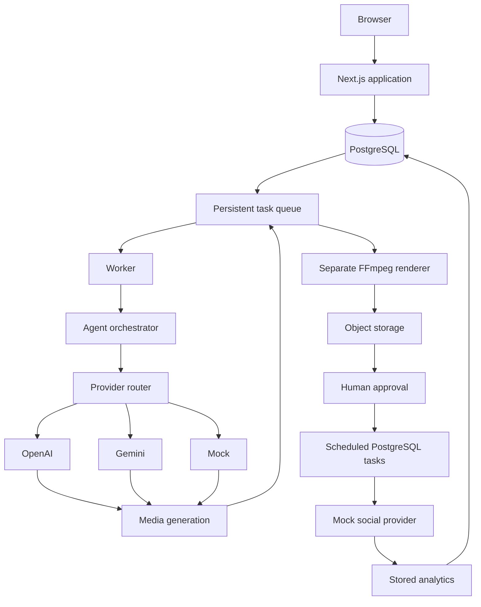
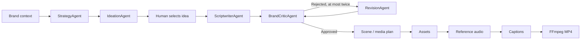

# ContentForge

### Agentic Media Generation Platform

ContentForge turns a small business's brand context into reviewed, playable short videos. A strategist and ideation agent plan the campaign; a scriptwriter, independent brand critic, and bounded revision agent develop the content. PostgreSQL queues drive media generation, FFmpeg rendering, human approval, scheduling, mock publishing, and stored analytics across separate web, worker, and renderer processes.

Built with **Next.js 15, React 19, strict TypeScript, Prisma/PostgreSQL, Zod, FFmpeg, Vitest, and Playwright**. This is the application in the `Agentic-Media-Generation-Platform` repository; the repository name is unchanged.





## What works

- **Implemented:** durable queue with transactional reservation, fenced leases, idempotency, retries, dead letters and cancellation; typed agents and persisted timelines; brand/campaign editing; idea acceptance; script/scene/caption editing and version comparison; real MP4 rendering; signed preview downloads; approval-gated scheduling; filtered analytics and CSV export with evidence references.
- **Mock/local:** deterministic text and PNG generation, WAV reference tone (not human speech), mock social publishing and analytics. Primary production supports 9:16 short videos. Seed fixtures also demonstrate other aspect ratios.
- **Optional real integrations:** OpenAI Responses text generation, Gemini Interactions text generation, and OpenAI PNG generation use pinned official SDKs. They require API keys and model configuration. Tests replace SDK/HTTP boundaries and make no paid calls.
- **Setup required / not implemented:** real social OAuth/publishing, real speech/transcription/video generation, Stripe checkout/webhooks, GCS and Cloud Tasks adapters. Terraform is a deployment scaffold, not a deployed cloud workflow.

## Local demo

Requirements: Node.js 22+, pnpm 9.15, and PostgreSQL (Docker Compose recommended). FFmpeg is bundled by `ffmpeg-static`; containers install FFmpeg and fonts. Set `FFMPEG_PATH` if needed. No paid account is required.

```bash
cp .env.example .env
# Replace AUTH_SECRET and ENCRYPTION_KEY with generated local values.
pnpm install --frozen-lockfile
docker compose up -d postgres
pnpm db:migrate
pnpm db:seed
pnpm dev
```

Open `http://localhost:3000`, sign in with the **seeded demo user**, and open **Riverbend Coffee Roasters**. `pnpm dev` starts web, worker, and renderer. Create a campaign, generate strategy and ideas, accept a short video idea, and generate its video in the studio. Follow the persisted run, review the MP4, approve with compliance acknowledgment, and schedule it for the mock account. See [the walkthrough](docs/demo-script.md).

The development-only demo login is unavailable in production. Production authentication uses email magic links; console delivery remains a local mechanism. See [deployment limitations](DEPLOYMENT.md).

Without Docker, `pnpm --filter @contentforge/database dev:db` runs the existing embedded PostgreSQL fallback; set DATABASE_URL to its printed local URL. Integration and E2E tests create isolated databases and do not modify the development database.

All processes must use the same DATABASE_URL, AUTH_SECRET, and LOCAL_STORAGE_DIR. Relative local storage resolves against the repository root. Compose mounts a shared media volume. For the full container stack, build the images, then run `docker compose run --rm renderer pnpm --filter @contentforge/database db:migrate` and `docker compose run --rm renderer pnpm --filter @contentforge/database db:seed` before `docker compose up`. Running seed in the renderer container writes media into the shared volume. Production containers require configured authentication; use `pnpm dev` for the development demo login.

## Validation

```bash
pnpm format:check
pnpm lint
pnpm typecheck
pnpm test
pnpm test:integration
pnpm build
pnpm test:e2e
```

Run root checks sequentially on Windows: Prisma generation and Next build artifacts must not be rewritten concurrently. E2E uses isolated services on ports 3100-3102 and an installed Playwright Chromium browser. [Implementation report](docs/implementation-report.md) records executed commands and limitations.

See [architecture](ARCHITECTURE.md), [data model](DATA_MODEL.md), [provider setup](PROVIDERS.md), [security](SECURITY.md), and [task status](TASKS.md).
