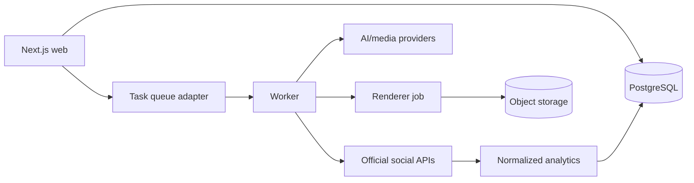

# ContentForge

ContentForge is a multi-tenant, human-approved AI content planning, production, scheduling, publishing, and analytics SaaS for small businesses. The local experience uses deterministic mock providers, local storage, PostgreSQL, FFmpeg, and a mock social network—no paid account is required.



## Local setup

Requirements: Node.js 20+, pnpm 9.15, PostgreSQL 16 (or Docker), and FFmpeg for real local rendering.

```bash
cp .env.example .env
pnpm install
docker compose up -d postgres
pnpm db:migrate
pnpm db:seed
pnpm dev
```

Open `http://localhost:3000`, choose **Sign in**, and use `demo@contentforge.dev`. Local email delivery writes the magic link to the application console. The seeded workspace is **Riverbend Coffee Roasters** (`riverbend-coffee`). See [the demo walkthrough](docs/demo-script.md).

The full container stack is `docker compose up --build`. Adminer is on port 8080, the worker health endpoint on 3001, and renderer health endpoint on 3002.

## Environment and providers

`.env.example` is the authoritative variable list. Defaults are `mock` for AI/social, `local` for storage/queue, and `console` for email. Real Instagram, YouTube, Stripe, GCS, and Cloud Tasks integrations remain disabled and visibly say **Setup required** until official credentials are supplied. OAuth tokens are encrypted and never returned from application APIs.

## Commands

```bash
pnpm db:generate
pnpm db:migrate
pnpm db:seed
pnpm lint
pnpm typecheck
pnpm test
pnpm test:integration
pnpm test:e2e
pnpm build
pnpm --filter @contentforge/renderer render:demo
```

The last command creates a real playable MP4 in `.local-storage/demo/` using a safe FFmpeg argument array.

## Deployment

Dockerfiles live in `infra/docker`; Terraform provisions Cloud Run web/worker, a Cloud Run rendering job, Cloud SQL, GCS, Cloud Tasks, Scheduler, Secret Manager, and Artifact Registry. CI validates formatting, types, tests, builds, migrations, Compose, and images. Deployment is deliberately disabled until Workload Identity and project secrets exist. See [DEPLOYMENT.md](DEPLOYMENT.md).

## Known limitations

- Real social publishing needs each platform's developer approval and credentials.
- Stripe checkout/portal needs test-mode keys and price IDs.
- The mock renderer uses generated graphics and a tone track; production voice/media adapters are contracts, not fabricated provider implementations.
- Local in-memory queue state does not survive a process restart; Cloud Tasks is the production adapter boundary.
- Cross-platform analytics retain differing platform definitions.

Architecture and boundaries are in [ARCHITECTURE.md](ARCHITECTURE.md), the schema narrative in [DATA_MODEL.md](DATA_MODEL.md), security model in [SECURITY.md](SECURITY.md), and live status in [TASKS.md](TASKS.md).
